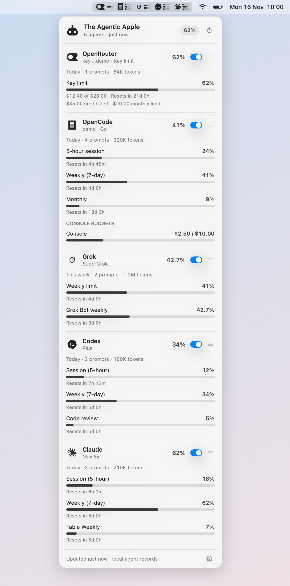

# The Agentic Apple

One macOS menu bar item for every AI agent this Mac actually uses.
**OpenRouter, OpenCode, Grok, Codex and Claude** each keep their own mark and
their own limit meters; an agent you have no plan, key or usage for simply
stays out of the bar. That is also the default bar order.

[](https://github.com/crueber/the-agentic-apple/actions/workflows/ci.yml)
[](LICENSE)
[](#requirements)

<p align="center">
  <picture>
    <source media="(prefers-color-scheme: dark)" srcset="docs/images/preview-dark.png">
    <source media="(prefers-color-scheme: light)" srcset="docs/images/preview-light.png">
    
  </picture>
</p>

**Website:** <https://crueber.github.io/the-agentic-apple/>

All images in this repository are composed from invented data: no real key,
account, workspace, spend, credits or usage figure is shown.

The Agentic Apple is a native Swift port of the Omarchy plugin
[Agent Meters](https://github.com/crueber/omarchy-plugin-agent-meters): the same
agents, the same rules and the same panel, rebuilt for the macOS menu bar with
no Node, no Omarchy and no daemon of its own.

## Contents

- [What you get](#what-you-get)
- [Automatic selection](#automatic-selection)
- [Order, switches and dragging](#order-switches-and-dragging)
- [Each agent in detail](#each-agent-in-detail)
- [How it fetches](#how-it-fetches)
- [Colours and thresholds](#colours-and-thresholds)
- [Install](#install)
- [Use](#use)
- [Settings](#settings)
- [Privacy and security](#privacy-and-security)
- [Known limitations](#known-limitations)
- [Troubleshooting](#troubleshooting)
- [Remove](#remove)
- [Development](#development)
- [Credits](#credits)
- [Licence and trademarks](#licence-and-trademarks)

## What you get

| Agent | Menu bar | Panel rows |
| --- | --- | --- |
| **OpenRouter** | OpenRouter mark + meter, or dollars | This cycle's spend against the key's own limit (or the previous cycle), account credits, reset |
| **OpenCode** | OpenCode mark + up to three meters | 5-hour session, weekly, monthly, Console budgets, today's activity |
| **Grok** | Grok mark + plan and Grok Bot meters | Weekly (or daily/monthly) plan limit, Grok Bot's separate weekly allowance, this week's local activity |
| **Codex** | Codex mark + up to three meters | Session, weekly, code review, model-scoped allowances, a Business seat's spend cap |
| **Claude** | Anthropic asterisk + up to three meters | Session (5-hour), weekly (7-day), model-scoped allowances (e.g. Fable weekly), today's activity |

Every agent gets:

- its mark drawn as a monochrome vector that follows the menu bar's own
  colour, light or dark, and stays crisp at menu bar size;
- one meter per limit window (the bar draws the first three), coloured by that
  window's own state;
- a panel section with percentages, meters, reset countdowns and captions;
- an optional local-activity line (today, or this week for Grok);
- a show switch and a drag handle.

The agent marks are deliberately **not** tinted by state. When something is at
its limit, the meter and the percentage turn critical; the mark stays in the
menu bar colour beside its neighbours.

Three bar styles are available: **Meters** (mark plus up to three tiny stacked
meters, the default), **Percentages** (mark plus `5h 18% · 7d 62%`) and
**Marks only**.

## Automatic selection

Every refresh runs all five sources concurrently and reports what each agent's
own source says. The bar only draws the agents that pass:

- **OpenRouter** — appears when a key is found in `OPENROUTER_API_KEY`, an
  explicit auth file (the **OpenCode auth file** setting or
  `OPENROUTER_AUTH_FILE`), OpenCode's `auth.json`, or OpenCode 2's credential
  store (`opencode auth export`). Keys are never cached.
- **OpenCode** — appears when the installed `opencode` answers with a Go
  allowance.
- **Grok** — appears when Grok's local billing snapshot has a reading.
- **Codex** — appears when the Codex CLI is signed in to a plan with rate
  limits. An API-key sign-in has no plan limits and stays out of the bar.
- **Claude** — appears when Claude Code has a plan or limits. An expired
  sign-in still appears, labelled *Sign-in expired*, with a hint to run
  `claude auth login`.

An agent with no plan, no key and no usage is left out rather than shown as an
empty shell. Detection is per Mac: copy the app to another computer and it
shows that computer's agents.

> **Environment variables and GUI apps.** An app launched from Finder, Spotlight
> or at login does not inherit the variables your shell's startup files export.
> So once per launch The Agentic Apple asks your login shell (`$SHELL -l -i`)
> for its `PATH` and for these variables only: `OPENROUTER_API_KEY`,
> `OPENROUTER_AUTH_FILE`, `CODEX_HOME`, `CODEX_ACCESS_TOKEN`,
> `CLAUDE_CONFIG_DIR`, `XDG_DATA_HOME`, `XDG_CONFIG_HOME`, `MISE_DATA_DIR`,
> `GROK_HOME` and `GROK_BOT_HOME`. Set in `~/.zshrc` (or your shell's
> equivalent), they reach the menu bar app as well as `agentic-apple --text`.
> Nothing else from the shell is kept. A value changed in your startup files
> takes effect at the app's next launch. If the shell does not answer in time,
> the app carries on with its own environment and the well-known tool
> directories.

## Order, switches and dragging

- **Default order:** OpenRouter, OpenCode, Grok, Codex, Claude. A saved
  `providerOrder` wins; agents missing from it are appended in the default
  order, so a newly supported agent appears without a settings edit.
- **Drag to reorder:** grab an agent section by its `⠿` grip and drop it where
  you want it. A ghost follows the pointer, an accent line shows the insertion
  point, and the menu bar follows immediately. The **Agents** settings pane
  offers the same list with drag handles and a **Reset Order** button.
- **Show switches:** every section has a switch, on by default. Turning one off
  keeps the section — and its limits — in the panel, marked *Hidden from bar*,
  so you can read it or switch it back on; only its mark and meters leave the
  menu bar. The panel header counts hidden agents, and an all-hidden bar shows
  a dimmed robot glyph whose tooltip says so.
- The panel, the Settings window and `defaults` all write the same keys
  (`providerOrder`, `show<Agent>`), so they never drift.

## Each agent in detail

### OpenRouter

OpenRouter has no subscription. The app asks OpenRouter for the key's own
budget with `GET https://openrouter.ai/api/v1/key`; the key is used only in an
HTTPS `Authorization` header. Account credits come from
`GET https://openrouter.ai/api/v1/credits` when OpenRouter reports them.

Key lookup, first match wins:

1. `OPENROUTER_API_KEY` (see the note on [environment
   variables](#automatic-selection));
2. the **OpenCode auth file** setting, else `OPENROUTER_AUTH_FILE` — only that
   file is read;
3. `$XDG_DATA_HOME/opencode/auth.json`, then `~/.local/share/opencode/auth.json`
   (an `openrouter` entry with `key` or `apiKey`);
4. `opencode auth export openrouter`, then `opencode auth export` (OpenCode 2).
   The output stays in memory.

What the meter shows:

- **Limited key:** a meter of current-cycle spend against the key's limit.
- **No key limit:** the spend in dollars. Once one completed cycle has been
  observed, the previous cycle's spend becomes the effective limit and a meter
  appears. Going over it switches back to dollars and turns yellow.
- **Zero spend:** only the mark is drawn; the panel still shows the cycle,
  limit and reset details.
- **Previous cycle:** exactly one current and one previous cycle are kept. A
  previous cycle is used only when it was observed within six hours of its
  reset, so a partial or missed cycle cannot become a misleading baseline.
- **Key label:** reduced to a three-character tail (`key …2eb`); the rest of
  OpenRouter's label is never displayed or cached.
- **Reset:** the key's own reset interval and date, monthly by default.

### OpenCode

The numbers come from the local OpenCode service — no second login, no key to
paste:

```bash
opencode api GET /api/experimental/usage/limits
```

That endpoint reports the Go allowance and Console budgets of the workspace
your installed OpenCode is signed in to. If it does not answer, the app retries
once with `opencode api --standalone GET …`, which starts a private server for
that request and reads the same credentials.

The panel shows the 5-hour session, weekly and monthly windows, up to six
Console budgets, and today's prompts and tokens. Activity is read from
OpenCode's own SQLite store (`~/.local/share/opencode/opencode.db`, or under
`$XDG_DATA_HOME`) with `/usr/bin/sqlite3 -readonly`; the query selects only
counts and token sums, never message text. Both OpenCode 2 (`session_message`)
and OpenCode 1 (`message`) schemas are understood.

A signed-out OpenCode reports *Not signed in* and a workspace without Go *No Go
plan*; both leave OpenCode out of the bar, so look for them in
`agentic-apple --json`. **The endpoint is experimental**, so a future OpenCode release may change
its shape.

### Grok

There is no API key, no network request and no second login. The installed Grok
CLI asks its own service for billing data when a session starts and logs the
answer to:

```text
~/.grok/logs/unified.jsonl
```

The app scans that log backwards (at most 32 MB) for the last
`billing: fetched credits config` line, and reads the plan pool's percentage,
period and tier from it. The window is labelled from its own period: *Weekly
limit*, *Daily limit* or *Monthly limit*. For local activity it sums the
numeric per-turn ledgers under `~/.grok/sessions/<workspace>/<session>/usage.json`
for the current period. Prompts, responses and `~/.grok/auth.json` are never
opened. The Grok home is the **Grok home** setting, else `$GROK_HOME`, else
`~/.grok`.

**Grok Bot** has a separate weekly allowance. Its desktop app caches the reading
as small JSON `*.blob` files; the app reads the newest one (≤ 64 KB) for
`percentUsed` and `nextResetMs`. Directories tried, in order: the **Grok Bot
cache** setting, else `$GROK_BOT_HOME`, else

1. `~/Library/Application Support/Grok Bot/sand-client-persistence`
2. `~/.config/Grok Bot/sand-client-persistence` (or under `$XDG_CONFIG_HOME`)

Open Grok Bot to refresh that cache. A reading past its expiry or its reset is
shown as *stale* with an em dash.

Grok only updates its snapshot when a Grok session runs — also the only time
your allowance can change — so run `grok` once (and open `/usage` if this is the
first time) to create the first snapshot. A plan window past its period end is
marked stale until the next session writes a fresh one.

### Codex

Codex limits come from the Codex app-server, the same RPC Omarchy's Codex
collector uses. Each refresh the app starts:

```bash
codex -s read-only -a on-request app-server
```

and speaks newline-delimited JSON-RPC to it on stdio: `initialize` →
`initialized` → `account/rateLimits/read` (falling back to `account/read` only
to name the plan). The process is shut down as soon as it answers; each request
has an 8-second timeout. What it shows:

- the general **session** and **weekly** windows;
- **code-review** windows when the account has them;
- a **model's own allowance**, titled with its name and span, kept as a
  separate row;
- a Business seat's **spend cap** when that is what the app-server reports;
- the plan as Codex's own `/status` names it (*Plus*, *Pro 200*, *Business*, …).

Finding `codex`: the **codex** setting if set; else the first real `codex` on
the search path, skipping mise shims and other lazy launchers; else
`mise which codex` with `MISE_OFFLINE=1`; else a real binary under mise's
`installs/` (including an npm-installed codex inside a mise node version, run
with its own `node` first on `PATH`).

Before starting the app-server, the app checks `~/.codex` (or `$CODEX_HOME`)
for credentials: it parses `auth.json` only for `auth_mode` and whether an API
key is present, and reads `cli_auth_credentials_store` from `config.toml`. No
token value is read or kept. Without credentials Codex stays out of the bar
(`--json` reports *Waiting for auth*); an API-key sign-in has no plan limits and stays out of the bar. Run
`codex login` to use a subscription plan.

### Claude

Claude's limits come from the same OAuth usage endpoint Claude Code's `/usage`
uses, ported from Omarchy's Claude collector:

```text
GET https://api.anthropic.com/api/oauth/usage
```

The OAuth token is read, never refreshed and never written:

1. the macOS Keychain item **Claude Code-credentials**, through
   `/usr/bin/security find-generic-password -s "Claude Code-credentials" -w`
   (see [the Keychain prompt](#the-keychain-prompt));
2. `~/.claude/.credentials.json` (or under `$CLAUDE_CONFIG_DIR`).

When both exist, the one with the later expiry wins. The plan label (*Max 5x*,
*Pro*, *Team 5x*) comes from the credentials and Claude Code's profile
(`~/.claude.json`).

Windows:

- **Session (5-hour)**
- **Weekly (7-day)**
- **Model-scoped allowances** — any model's own allowance the endpoint reports,
  such as **Fable weekly**, shown as its own meter and row.

Sign-in states:

| Status | Meaning | Fix |
| --- | --- | --- |
| *Sign-in expired* | The access token and its refresh token have lapsed, or Anthropic refused the token | `claude auth login` (or start Claude Code) |
| *Limits paused* | The access token lapsed but Claude Code can still refresh it | Start Claude Code; no new sign-in needed |
| *Waiting for auth* | `~/.claude` exists but holds no sign-in | `claude auth login` |

In the first two states Claude stays in the bar (once it has a plan or earlier
numbers) and keeps its last numbers, marked stale, so the meters return as soon
as the sign-in is fixed. *Waiting for auth* leaves Claude out of the bar; you
see it in `agentic-apple --json`.

Today's prompts and tokens are counted from Claude Code's transcripts under
`~/.claude/projects/**/*.jsonl`. Only typed prompts count (not tool results,
subagent tasks or local slash commands such as `/clear`), and each reply's
tokens are counted once. The scan is incremental: each refresh reads only the
bytes appended since the last one.

## How it fetches

One collector feeds the whole app. Each provider keeps its own source, and the
collector normalises them into the same shape:

| Agent | Source |
| --- | --- |
| OpenRouter | `OPENROUTER_API_KEY`, an auth file, OpenCode's `auth.json`, or `opencode auth export`; then `/api/v1/key` and `/api/v1/credits` |
| OpenCode | `opencode api GET /api/experimental/usage/limits` (retries `--standalone`); activity from `opencode.db` via `sqlite3 -readonly` |
| Grok | `~/.grok/logs/unified.jsonl`, `~/.grok/sessions/**/usage.json`, and the Grok Bot app cache |
| Codex | `codex -s read-only -a on-request app-server` → `account/rateLimits/read` |
| Claude | Keychain or `~/.claude/.credentials.json`, then `api.anthropic.com/api/oauth/usage`; activity from `~/.claude/projects` |

Schedule and caching:

- **Automatic refresh:** `refreshIntervalSec`, default **5 minutes**
  (60–3600 seconds).
- **Manual refresh** (the panel's button, `R`, middle click, **Refresh Now**):
  at most once every **30 seconds**.
- **Back-off:** when every detected agent fails at once (typically no network)
  or the whole collection takes longer than 90 seconds, the next try waits
  **1, 2, 4, 8, then 10 minutes**.
- **Wake and open:** the app refreshes a few seconds after the Mac wakes, and
  when the panel opens on numbers older than the interval.
- **Cache:** the last result is written to
  `~/Library/Caches/com.crueber.agentic-apple/usage.json` after every attempt
  and painted immediately on the next launch; the app then waits out the rest
  of the refresh interval instead of re-reading.
- **Isolation:** a failed provider keeps its last good numbers and gains an
  error line. One endpoint being down never blanks the other agents. If the
  Keychain cannot be read for a moment, Claude keeps its last numbers. A
  collection that runs past 90 seconds counts as a failed attempt, but the
  next one waits until it has really finished.
- **Finding tools:** an app launched from Finder or at login does not inherit
  your shell's `PATH`. Once per launch the app runs your login shell
  (`$SHELL -l -i -c`, in its own session and bounded by a timeout) to read its `PATH` and the
  [allowlisted variables](#automatic-selection), then adds
  `~/.local/bin`, mise shims, `~/.bun/bin`, `~/.npm-global/bin`,
  `~/.opencode/bin`, `~/.cargo/bin`, `/opt/homebrew/bin` and `/usr/local/bin`.
  Set the **opencode** or **codex** command in Settings if a tool still is not
  found.

## Colours and thresholds

Each meter follows its own window:

1. **Red / critical** — at or above `criticalPercent` (default 90), or a window
   the source marks as limited.
2. **Orange / warning** — at or above `warnPercent` (default 70).
3. **Yellow** — OpenRouter only: the current cycle is over the previous
   completed cycle.
4. **Menu bar colour** — everything else.

`warningColor` and `criticalColor` override the built-in orange and red
(tuned separately for light and dark menu bars); empty values keep the
defaults. Agent marks always use the menu bar's own colour.

## Install

```bash
git clone https://github.com/crueber/the-agentic-apple && cd the-agentic-apple && scripts/install.sh
```

`scripts/install.sh` builds a release binary with SwiftPM, assembles
`The Agentic Apple.app`, signs it ad hoc, and then:

- quits a running copy and installs the app to `~/Applications`
  (set `INSTALL_DIR` to install elsewhere);
- links the command-line helper `~/.local/bin/agentic-apple` to the app's
  executable;
- opens the app (pass `--no-open` to skip).

The app lives in the menu bar only — no Dock icon, no main window. Its icon
(`Resources/AppIcon.icns`) shows in Finder, the About window and Login Items. To start it
at every login, turn on **Launch at Login** from its menu or Settings.

### Requirements

- macOS 14 Sonoma or later.
- A Swift 6 toolchain: Xcode, or just the Command Line Tools
  (`xcode-select --install`). No Xcode project, no third-party packages.
- At least one of:
  - an OpenRouter key (`OPENROUTER_API_KEY`, or signed in to OpenRouter through
    OpenCode);
  - OpenCode signed in to a workspace with a Go plan (`opencode auth login`);
  - the Grok CLI with an existing login and at least one session;
  - the Codex CLI signed in to a ChatGPT plan (`codex login`);
  - Claude Code signed in (`claude auth login`).

No administrator rights, no helper service, no daemon of its own.

### First launch and Gatekeeper

The app is **ad-hoc signed, not notarized** by Apple. Built from source on your
own Mac, as above, it carries no quarantine flag and opens without a warning.

A copy downloaded from the internet or received from another Mac is
quarantined, and Gatekeeper will refuse to open it at first. Any one of these
lets it through:

- **macOS 15 Sequoia and later:** try to open the app once, then go to
  **System Settings → Privacy & Security**, scroll to the message about
  The Agentic Apple and click **Open Anyway**.
- **macOS 14 Sonoma:** Control-click (or right-click) the app in Finder, choose
  **Open**, then **Open** again in the dialog. **Open Anyway** in Privacy &
  Security works here too.
- **Terminal, any version:** clear the quarantine flag yourself:

  ```bash
  xattr -dr com.apple.quarantine ~/Applications/"The Agentic Apple.app"
  ```

> [!NOTE]
> **From the author:** [*"If someone wants to pay for my Apple Developer Account, I'm happy to get rid of the annoying nag when installing this tool."*](https://github.com/sponsors/crueber)
> — the **Sponsor** button at the top of this repository goes to the same
> place.

### The Keychain prompt

Claude Code keeps its sign-in in your login Keychain. On the first refresh,
macOS asks whether `security` may use the item **Claude Code-credentials**.
Click **Always Allow**; with **Allow** alone the question returns on every
refresh.

Why it asks, and what happens to the token:

- The app reads the item through Apple's own `/usr/bin/security` tool rather
  than linking the Keychain directly, so the permission belongs to `security`
  and survives every ad-hoc rebuild of the app.
- The read is **read-only**. The token is held in memory for one request, sent
  only in the `Authorization` header to `api.anthropic.com`, and then dropped.
  It is never refreshed, written back, cached, logged or printed.
- When the token expires the app does not try to renew it. Claude shows
  *Sign-in expired* (or *Limits paused*, when only Claude Code needs to start)
  until you run `claude auth login`.
- If you click **Deny**, the app falls back to `~/.claude/.credentials.json`
  when it exists; otherwise Claude simply stays out of the bar.

No prompt appears if you do not use Claude Code.

### Verify your setup

The command-line helper runs the same collectors with the same settings and
prints the result without starting the UI:

```bash
agentic-apple --text   # one line per agent shown in the bar, or "no agents"
agentic-apple --json   # every agent (detected or not), its status, hint, error and windows
```

```text
$ agentic-apple --text
OpenRouter: 62%
OpenCode: 5h 24% · 7d 41% · 1m 9%
Grok: 7d 41% · bot 42.7%
Codex: 5h 12% · 7d 34% · rev 5%
Claude: 5h 18% · 7d 62% · fable 7%
```

(Invented figures, from `agentic-apple --fixture --text`.) `--json` lists all
five agents with `available` and `shown`, so an agent missing from the bar
shows its `status`, `hint` and `error` there. Neither mode ever prints a key or
token. If `agentic-apple` is not found, add `~/.local/bin` to your `PATH` or
run the app's executable directly:
`~/Applications/"The Agentic Apple.app"/Contents/MacOS/agentic-apple --text`.

Running these from a terminal also triggers the Keychain prompt above the first
time. A terminal passes your whole shell environment; the menu bar app gets
only the [allowlisted variables](#automatic-selection) from your login shell.

## Use

- **Left click** — open or close the panel.
- **Right click** or **Control-click** — the menu: **Refresh Now** (`⌘R`),
  **Settings…** (`⌘,`), **Launch at Login**, **About The Agentic Apple**,
  **Quit The Agentic Apple** (`⌘Q`).
- **Middle click** — refresh every agent now.
- **Opening the app again** (Finder, Spotlight, `open`) while it runs — opens
  the panel. Only one copy runs at a time.

In the panel:

- **`R`** — refresh.
- **`Esc`** — close.
- **`⌘,`** or the gear in the footer — Settings.
- **Drag the `⠿` grip** — reorder agents.
- **Switch** — show or hide an agent in the menu bar.
- **Hover** the menu bar item — a tooltip with every shown agent's windows and
  reset times.

The panel header shows the number of agents, how many are hidden, when the
numbers were read, and the highest limit currently in the menu bar.

## Settings

Open **Settings…** from the menu or the panel. It has five panes:

| Pane | What it holds |
| --- | --- |
| **General** | Menu bar style (Meters, Percentages, Marks only); refresh interval (1 minute to 1 hour); local-activity line; Launch at login |
| **Agents** | All five agents with drag handles and show switches, whether each is detected on this Mac, **Reset Order** |
| **Thresholds** | Warning and critical sliders, warning and critical colours (**Use Default** clears them), a live preview |
| **Advanced** | Paths to `opencode` and `codex`; Grok home, Grok Bot cache, OpenCode auth file; **Reveal Cache in Finder**, **Clear Cache** |
| **About** | Version and links |

The usual editing shortcuts (`⌘C`, `⌘V`, `⌘X`, `⌘A`, `⌘Z`) work in the
Settings text fields, and `⌘W` closes the window.

Settings are stored in the user defaults domain `com.crueber.agentic-apple`,
under the same keys as the Omarchy plugin. Every change in the window is saved
and applied at once. You can also script them with `defaults` — quit the app
first, because it reads the domain only at launch:

```bash
osascript -e 'tell application id "com.crueber.agentic-apple" to quit'
defaults write com.crueber.agentic-apple refreshIntervalSec -int 600
defaults write com.crueber.agentic-apple barStyle -string text
defaults write com.crueber.agentic-apple showCodex -bool false
defaults write com.crueber.agentic-apple providerOrder -string "claude,codex"
defaults write com.crueber.agentic-apple warningColor -string "#f67400"
open -b com.crueber.agentic-apple

defaults read com.crueber.agentic-apple          # what is set
defaults delete com.crueber.agentic-apple        # back to every default
```

Use the types shown: a `show…` key written as a string reads as *shown*.

| Key | Type | Default | Meaning |
| --- | --- | --- | --- |
| `barStyle` | string | `bars` | `bars` (meters), `text` (short percentages per agent) or `icon` (marks only) |
| `showOpenrouter` | bool | `true` | Show OpenRouter in the menu bar |
| `showOpencode` | bool | `true` | Show OpenCode in the menu bar |
| `showGrok` | bool | `true` | Show Grok in the menu bar |
| `showCodex` | bool | `true` | Show Codex in the menu bar |
| `showClaude` | bool | `true` | Show Claude in the menu bar |
| `providerOrder` | string | `""` | Comma-separated ids (`openrouter,opencode,grok,codex,claude`); missing ids follow in the default order; empty uses the default |
| `refreshIntervalSec` | int | `300` | Automatic refresh, clamped to 60–3600 |
| `warnPercent` | int | `70` | Warning threshold, 0–100 |
| `criticalPercent` | int | `90` | Critical threshold, 0–100 |
| `warningColor` | string | `""` | `#rrggbb`; empty uses the built-in orange |
| `criticalColor` | string | `""` | `#rrggbb`; empty uses the built-in red |
| `showActivity` | bool | `true` | Show the local-activity line per agent |
| `opencodeCommand` | string | `""` | Path to `opencode`; empty searches the login `PATH` |
| `codexCommand` | string | `""` | Path to `codex`; empty searches the login `PATH`, mise and its installs |
| `grokHome` | string | `""` | Grok home; empty uses `$GROK_HOME` or `~/.grok` |
| `botHome` | string | `""` | Grok Bot cache directory; empty tries the locations listed under [Grok](#grok) |
| `authFile` | string | `""` | An OpenCode 1 `auth.json` holding the OpenRouter key; when set, only this file is read |

**Launch at login** is managed by macOS (`SMAppService`) and also appears under
**System Settings → General → Login Items**; toggle it from the app, not with
`defaults`.

## Privacy and security

- **Keys and tokens are never cached, logged, printed or passed on a command
  line.** The OpenRouter key is used only in an HTTPS `Authorization` header to
  `openrouter.ai`; Claude's OAuth token only in one to `api.anthropic.com`. Both
  are re-read at request time and dropped afterwards. Error text from either
  service is scrubbed of the key before display.
- **Network requests made by the app:** OpenRouter's `/api/v1/key` and
  `/api/v1/credits`, and Anthropic's `/api/oauth/usage`. That is all. HTTPS
  only, no redirects followed, no cookies, no URL cache, 15-second timeout,
  1 MB response cap. `opencode` and the Codex app-server, when the app starts
  them, make their own requests under their own credentials.
- **No telemetry, no analytics, no update checks.**
- **Local reads:** Claude Code's Keychain item and credential file, profile and
  transcripts; Codex's `auth.json` (mode and key presence only) and
  `config.toml`; `~/.grok` logs and session ledgers (never `auth.json`); the
  Grok Bot app cache; OpenCode's `auth.json`, `opencode.db` (counts only) and
  local API.
- **Cache:** `~/Library/Caches/com.crueber.agentic-apple/`, a mode-`0700`
  directory with two mode-`0600` files:
  - `usage.json` — displayed numbers, plan labels, statuses, reset times,
    today's activity counts, the masked OpenRouter key label and the OpenRouter
    cycle baseline;
  - `claude-activity.json` — the incremental transcript scan for today: the
    paths of today's transcript files, byte offsets, counts and 64-bit hashes
    of message ids.

  Neither holds prompts, responses, keys or tokens. **Clear Cache** in Settings
  removes both, forgets the numbers on screen (OpenRouter's previous cycle and
  Claude's activity scan included) and fetches afresh; deleting the directory
  while the app is quit does the same.
- **Untrusted text:** every string from a file, a command or the network is
  bounded and neutralised before display; percentages are clamped to 0–100;
  command output, files and responses are size- and time-limited.
- **Executables run:** `/usr/bin/security`, `/usr/bin/sqlite3`, `opencode`,
  `codex`, `mise` (only `mise which codex`, offline) and, once per launch, your
  login shell to read `PATH` and the allowlisted variables. Never through a shell string; arguments are
  passed directly.
- The app writes nothing outside its cache directory and its defaults domain
  (plus the optional login item).

See [`SECURITY.md`](SECURITY.md) for reporting and the full data-flow notes.

## Known limitations

- **Grok is ported, not field-tested on macOS.** Its reader is a faithful port
  of the Omarchy plugin's and passes the offline fixtures, but it has not been
  checked against a live Grok install on a Mac.
- **Grok Bot's macOS cache path is an assumption.** The app looks in
  `~/Library/Application Support/Grok Bot/sand-client-persistence` first (the
  Electron convention), then the Linux-style `~/.config` path. If your Grok Bot
  keeps it elsewhere, set **Grok Bot cache** in Settings — and please open an
  issue with the path.
- **OpenCode's usage endpoint is experimental** (`/api/experimental/…`) and may
  change shape in a future OpenCode release.
- **Codex starts its own app-server briefly each refresh** — a short-lived
  `codex app-server` process, shut down as soon as it answers. That is how
  Codex exposes its limits; there is no file to read instead.
- **Only allowlisted shell variables reach the menu bar app**, read once per
  launch (see [Automatic selection](#automatic-selection)).

## Troubleshooting

**No agents in the menu bar.** Run `agentic-apple --text`. If it prints
`no agents`, either none of the five sources is configured on this Mac or every
agent is switched off; `agentic-apple --json` shows each agent's `available`,
`shown`, `status`, `hint` and `error`. The panel's empty state names the
sign-in path for each agent.

**The CLI finds an agent but the menu bar does not.** The difference is
almost always the environment: your terminal exports everything, the menu bar
app only the [allowlisted variables](#automatic-selection) from your login
shell, read at launch. Quit and reopen the app after changing your startup
files, or set the matching path in **Settings → Advanced** and refresh.

**An agent should appear but does not.**

| Agent | Check |
| --- | --- |
| OpenRouter | `OPENROUTER_API_KEY` exported by your login shell, `opencode auth export` contains an `openrouter` credential, or set **OpenCode auth file** |
| OpenCode | `opencode auth list`; `opencode api GET /api/experimental/usage/limits` answers with a `go` block |
| Grok | `~/.grok/logs/unified.jsonl` exists; run `grok` once and open `/usage` |
| Codex | `codex login`; an API-key sign-in intentionally has no plan limits; set **codex** in Settings if it lives somewhere unusual |
| Claude | `claude auth login`; allow `security` at the Keychain prompt |

**Claude says "Sign-in expired".** Run `claude auth login` (or start Claude
Code) and refresh. **"Limits paused"** only needs Claude Code to start once.
Claude stays visible either way, with its last numbers marked stale.

**The Keychain prompt keeps coming back.** Click **Always Allow**, not
**Allow**. If you clicked **Deny**, the prompt returns at the next refresh;
choose **Always Allow** then.

**"codex not found in PATH".** Set the full path to `codex` in
**Settings → Advanced**. Check what your shell resolves with `command -v codex`
(a mise shim with no version selected cannot run; the app skips it).

**Grok Bot shows an em dash or "stale reading".** Its cached reading has
expired. Open the Grok Bot desktop app to refresh it.

**OpenCode did not answer.** The endpoint is experimental. Confirm the CLI
works with `opencode api GET /api/experimental/usage/limits`; the app also
retries once with `--standalone`.

**OpenRouter is missing.** Without a key, OpenRouter is simply left out — no
error, `available: false` in `--json`. Export `OPENROUTER_API_KEY` from your
login shell, sign in to OpenRouter in OpenCode (`opencode auth login`), or
point **OpenCode auth file** at a file with an `openrouter` entry. OpenCode 2
users need no extra step: the app reads `opencode auth export`.

**Numbers look old.** Open the panel or press `R`; the footer says when they
were read. After a failure the next try backs off up to 10 minutes, and a
manual refresh is allowed every 30 seconds.

**macOS will not open the app.** See [First launch and
Gatekeeper](#first-launch-and-gatekeeper).

**Launch at login does not stick.** Approve it under **System Settings →
General → Login Items** if macOS asks. It only works from the installed
`.app`, not from `swift run`.

## Remove

```bash
scripts/uninstall.sh
```

The script quits the app, unregisters its login item (it runs the installed
app's `agentic-apple --unregister-login-item`), deletes it from
`~/Applications` and `/Applications`, removes the `~/.local/bin/agentic-apple`
link, the cache directory and the `com.crueber.agentic-apple` defaults domain.
To do it by hand:

```bash
osascript -e 'tell application id "com.crueber.agentic-apple" to quit'
~/Applications/"The Agentic Apple.app"/Contents/MacOS/agentic-apple --unregister-login-item
rm -rf ~/Applications/"The Agentic Apple.app" ~/.local/bin/agentic-apple
rm -rf ~/Library/Caches/com.crueber.agentic-apple
defaults delete com.crueber.agentic-apple
```

If you clicked **Always Allow** at the Keychain prompt, that permission belongs
to `/usr/bin/security` on the Claude Code item; remove it in Keychain Access if
you like. The app writes nothing else.

## Development

The repository is a plain Swift package — no Xcode project. `AGENTS.md`
documents the architecture and invariants for anyone, human or agent, changing
the app.

```bash
scripts/test.sh                 # offline self-test (every suite)
scripts/test.sh Claude          # one suite: Logic, Shell, OpenRouter, OpenCode, Grok, Codex, Claude
scripts/build-app.sh            # dist/The Agentic Apple.app, ad-hoc signed
scripts/install.sh --no-open    # build and install to ~/Applications
swift run agentic-apple --fixture --text
swift run agentic-apple --render-preview /tmp/previews
```

- **Tests** are an executable, `agentic-selftest`, with a tiny assertion
  harness: the Command Line Tools ship neither XCTest nor swift-testing. They
  are fully offline. Logic covers formatting, meter state, ordering, cycle
  history, merging, scheduling and the cache; each provider suite runs its
  collector against synthetic fixtures in `Tests/Fixtures/`, a temporary
  `HOME`, fake `opencode`/`codex` scripts and an injected HTTP client, so no
  real account, Keychain or network is touched.
- **`--fixture`** (or `AGENTIC_APPLE_FIXTURE=1`) swaps the real collectors for
  the invented preview data in `--text` and `--json`. `AGENTIC_APPLE_FIXTURE=1`
  also runs the menu bar app itself on that data (reset times follow the real
  clock, and the cache goes to a temporary directory, never your real one):
  `AGENTIC_APPLE_FIXTURE=1 "dist/The Agentic Apple.app/Contents/MacOS/agentic-apple"`.
- **`--render-preview <dir>`** writes the bar, the panel and the composite
  preview, light and dark, at @2x, from the same invented data, plus extra
  states (empty panel, bar styles, edge cases). The images in `docs/images/`
  come from it.
- `build-app.sh` honours `VERSION` (default: the `VERSION` file),
  `BUILD_NUMBER` and `SCRATCH_PATH`.
- CI (`.github/workflows/ci.yml`) runs the self-test and builds the app bundle
  on a macOS runner for every push to `main` and every pull request, and
  uploads the bundle, zipped with `ditto` so the executable bit survives, as an
  artifact.

Layout:

```text
Package.swift                 macOS 14+, three targets
Sources/AgenticCore/          pure logic, no AppKit
  Model/Provider.swift        ProviderID, Limit, Activity, Money, Budget, Provider, CollectorContext
  Logic/                      meter state, ordering, OpenRouter cycle history, merge, schedule,
                              formatting, summaries, cache
  Providers/                  one collector per agent, plus Collector, Shell, HTTP, Sanitize
Sources/AgenticApple/         the app (AppKit + SwiftUI)
  main.swift, App/            CLI modes, AppDelegate, Store (fetch lifecycle), settings, login item
  Bar/                        status item, bar view
  Panel/                      panel, agent sections, controls
  Settings/                   settings window and panes
  Marks/                      the monochrome agent marks as vector shapes
  Preview/                    --render-preview and the invented fixture
  Shared/                     DisplayState, palette
Sources/AgenticSelfTest/      offline test suites
Tests/Fixtures/               synthetic fixtures per agent
scripts/                      build-app, install, uninstall, test
docs/                         GitHub Pages site
```

### Adding a provider

1. Add a case to `ProviderID` (`Model/Provider.swift`), its `displayName`, and
   its place in `defaultOrder`.
2. Write `Providers/<Name>.swift`: a `ProviderCollector` that never throws,
   sets `available` only for a plan, key or usage, puts failures in `error`, and
   passes every outside string through `Sanitize`.
3. Register it in `Collector.all` and `Collector.live` (`Providers/Collector.swift`).
4. Add its mark to `Marks/MarkShapes.swift` and both switches in
   `Marks/ProviderMark.swift`.
5. Add its sign-in hint to `PanelEmptyState.paths` (`Panel/PanelView.swift`)
   and, ideally, an entry to `Preview/PreviewFixture.swift`.
6. Add a suite in `Sources/AgenticSelfTest/`, register it in that target's
   `main.swift`, and put synthetic fixtures under `Tests/Fixtures/<id>/`.

The show switch (`show<Id>`), ordering, settings and CLI pick it up from
`ProviderID.allCases`. Then update this README, `SECURITY.md` and `AGENTS.md`.

## Credits

- A port of [Agent Meters](https://github.com/crueber/omarchy-plugin-agent-meters)
  for Omarchy: its behaviour, text, colour rules and marks.
- The Claude and Codex sources are ported from Omarchy's own collectors,
  `omarchy-agent-usage-claude` and `omarchy-agent-usage-codex`, in
  [omacom/omarchy](https://github.com/omacom/omarchy).

If The Agentic Apple saves you a surprise rate limit, consider
[sponsoring](https://github.com/sponsors/crueber).

## Licence and trademarks

[MIT](LICENSE). Claude and Anthropic are trademarks of Anthropic; Codex and
OpenAI are trademarks of OpenAI; Grok and xAI are trademarks of their
respective owner; OpenCode and OpenRouter are trademarks of their respective
owners; Apple and macOS are trademarks of Apple Inc. The marks in this
repository are traced monochrome geometry used only to identify the service
each meter belongs to. This project is not affiliated with any of them.
